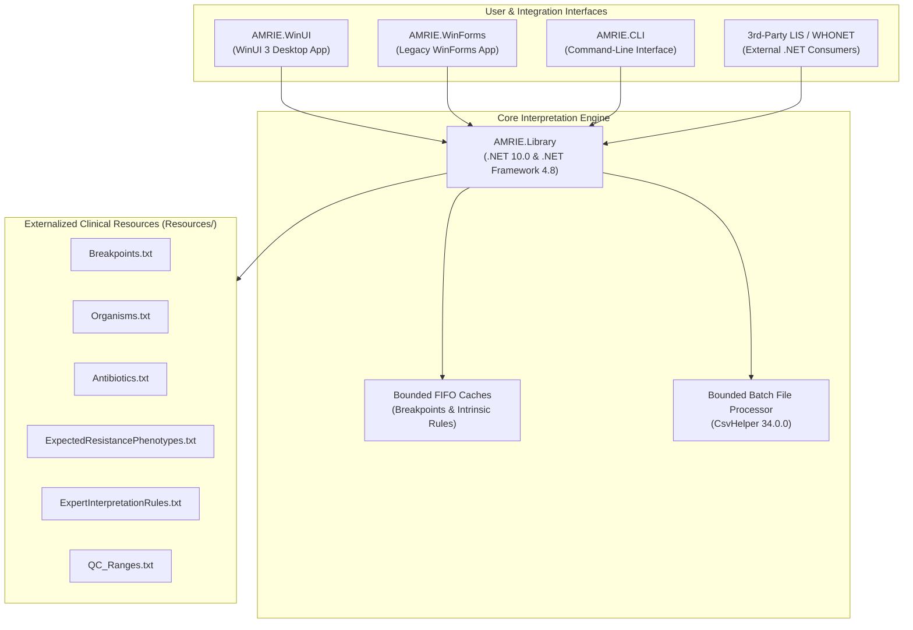

# AMRIE — Antimicrobial Resistance Test Interpretation Engine

[](https://dotnet.microsoft.com/)
[](https://learn.microsoft.com/en-us/windows/apps/winui/winui3/)
[](https://github.com/microsoft/winget-pkgs)
[](License.md)
[](CONTRIBUTING.md)

**AMRIE** (**A**ntimicrobial **R**esistance Test **I**nterpretation **E**ngine) is a clinical microbiology and public health software suite developed by the **[WHONET](https://whonet.org)** development team at **Brigham and Women's Hospital / Mass General Brigham** (WHO Collaborating Centre for Surveillance of Antimicrobial Resistance).

AMRIE automates the interpretation of quantitative antimicrobial susceptibility testing (AST) measurements—disk diffusion zone diameters (mm), minimal inhibitory concentrations (MIC, $\mu\text{g/mL}$), and ETest gradient strips—into clinical categories (**S**, **I**, **SDD**, **R**, **NS**, **WT**, **NWT**) and quality control ranges according to international guidelines:
- **[CLSI](https://clsi.org/)** — Clinical and Laboratory Standards Institute
- **[EUCAST](https://www.eucast.org/)** — European Committee on Antimicrobial Susceptibility Testing
- **[SFM](https://www.sfm-microbiologie.org/)** — Société Française de Microbiologie (CA-SFM)

---

## Table of Contents

- [Overview & Use Cases](#overview--use-cases)
- [Solution Architecture](#solution-architecture)
- [Installation](#installation)
- [Quickstart](#quickstart)
  - [1. Interactive Desktop Application](#1-interactive-desktop-application)
  - [2. Command-Line Interface (CLI)](#2-command-line-interface-cli)
  - [3. Library Integration (.NET 10 & .NET Framework 4.8)](#3-library-integration-net-10--net-framework-48)
- [Engine Capabilities & Performance](#engine-capabilities--performance)
- [Building & Testing from Source](#building--testing-from-source)
- [Documentation Library](#documentation-library)
- [Contributing, Support & Security](#contributing-support--security)
- [License & Attributions](#license--attributions)

---

## Overview & Use Cases

AMRIE is engineered to serve three distinct clinical and informatics workflows:

1. **Interactive Desktop Use (`AMRIE.WinUI` & `AMRIE.WinForms`):**
   - Perform ad-hoc single-isolate susceptibility lookups across organisms, antibiotics, test methods, host species, and infection sites.
   - Run batch interpretations on whole laboratory data files with live progress tracking.
   - Explore and filter the underlying organism taxonomies, antibiotic catalogs, clinical breakpoints, intrinsic resistance tables, and expert rules.
2. **Command-Line Automation (`AMRIE.CLI`):**
   - Integrate AST interpretation into automated shell scripts, ETL pipelines, and non-.NET bioinformatics workflows via whole-file batch processing or JSON-formatted single-isolate lookups.
3. **In-Process Library Integration (`AMRIE.Library`):**
   - Embed the core interpretation engine directly into Laboratory Information Systems (LIS), Electronic Health Records (EHR), or public health surveillance platforms (such as WHONET).
   - Multi-targeted for **.NET 10 LTS** (cross-platform: Windows, Linux, macOS) and **.NET Framework 4.8** (Windows legacy compatibility).

---

## Solution Architecture



| Project | Target Framework | Description |
| :--- | :--- | :--- |
| **`AMRIE.Library`** | `net10.0`, `net48` | Core AST interpretation engine, resource loaders, bounded file streaming, and caching. |
| **`AMRIE.CLI`** | `net10.0` | Command-line tool (`AMRIE.CLI.exe`) for batch file processing and single-measurement lookups. |
| **`AMRIE.WinUI`** | `net10.0-windows10.0.26100.0` | Modern Fluent Design desktop application built on WinUI 3 and Windows App SDK. |
| **`AMRIE.WinUI.Installer`** | WiX v5 (`x64`, `ARM64`) | Self-contained Windows Installer (MSI) bundling the WinUI 3 GUI, CLI, resources, and licenses. |
| **`AMRIE.WinForms`** | `net10.0-windows7.0` | Classic Windows Forms desktop interface retained for legacy workflows. |
| **`AMRIE.WinForms.Installer`** | WiX v5 (`x64`, `ARM64`) | Framework-dependent Windows Installer (MSI) for the WinForms desktop suite. |
| **`AMRIE.Library.DataGenerator`** | `net10.0` | Synthetic dataset generator for stress-testing and benchmarking large laboratory files. |
| **`AMRIE.Library.Tests`** | `net10.0` | xUnit regression suite covering measurement parsing, dilution rounding, breakpoint matrices, and expert rules. |

---

## Installation

### Windows Package Manager (WinGet)
Install the latest official release on Windows 10 or Windows 11 using `winget`:

```powershell
winget install WHONET.AMRIE
```

### MSI Installer Download
Download the latest architecture-specific installer (`AMR_Interpretation_Engine_WinUI_x64.msi` or `ARM64`) from the [GitHub Releases](https://github.com/WHONET-Development/AMRIE/releases) page. The WinUI MSI is self-contained and does not require a separate .NET runtime installation.

---

## Quickstart

### 1. Interactive Desktop Application
Launch **AMR Interpretation Engine** from the Start Menu or Desktop shortcut:
- **Single Interpretation:** Select a guideline year, organism (e.g., *Streptococcus pneumoniae* `spn`), antibiotic test (`AMC_NM`), and enter a quantitative measurement (`2`) to view the interpreted category and applicable rules.
- **Batch Processing:** Select a WHONET-formatted delimited text file, configure your interpretation settings, and export the interpreted dataset.
- **Resource Explorer:** Browse and filter the bundled organism, antibiotic, and breakpoint tables by guideline and year.

👉 *See the full [WinUI Desktop Quickstart](docs/tutorials/quickstart-winui.md).*

### 2. Command-Line Interface (CLI)
`AMRIE.CLI` supports two execution modes: `FILE` (whole-file batch processing) and `SINGLE_INTERPRETATION`.

**Batch File Interpretation:**
```powershell
dotnet run --project "AMRIE.CLI\AMRIE.CLI.csproj" -- FILE "AMRIE.Library\Resources\SampleConfig.json" "|" "AMRIE.Library\Resources\SampleInputFile.txt" "$env:TEMP\AMRIE-sample-output.txt"
```

**Single Measurement Interpretation:**
```powershell
dotnet run --project "AMRIE.CLI\AMRIE.CLI.csproj" -- SINGLE_INTERPRETATION "AMRIE.Library\Resources\SampleConfig.json" "spn" "AMC_NM" "2" "$env:TEMP\AMRIE-single-output.json"
```

👉 *See the [CLI Quickstart](docs/tutorials/quickstart-cli.md) and [CLI Reference](docs/reference/cli-reference.md).*

### 3. Library Integration (.NET 10 & .NET Framework 4.8)
Reference `AMRIE.Library\AMRIE.Library.csproj` from your .NET 10 or .NET Framework 4.8 project. Ensure the `Resources/` directory is deployed alongside your application binaries (`AppContext.BaseDirectory`).

**Evaluate a Single Measurement:**
```csharp
using AMRIE.Library;

// Load default configuration (latest guideline year, standard expert rules enabled)
InterpretationConfiguration config = InterpretationConfiguration.DefaultConfiguration();

// Interpret S. pneumoniae ("spn") tested against CLSI Amoxicillin/Clavulanic acid MIC ("AMC_NM") = 2 ug/mL
string interpretation = IsolateInterpretation.GetSingleInterpretation(config, "spn", "AMC_NM", "2");
Console.WriteLine($"Interpretation: {interpretation}");
```

**Process a Delimited Data File:**
```csharp
using System.ComponentModel;
using AMRIE.Library;

var parameters = new FileInterpretationParameters(
    inputFile_: @"AMRIE.Library\Resources\SampleInputFile.txt",
    delimiter_: '|',
    guidelineYear_: 2026,
    configFile_: @"AMRIE.Library\Resources\SampleConfig.json",
    outputFile_: @"output_interpreted.txt",
    worker_: null
);

var workArgs = new DoWorkEventArgs(parameters);
IO_Library.InterpretDataFileBounded(null, workArgs);
```

👉 *See the [Library Integration Quickstart](docs/tutorials/quickstart-library.md) and [API Reference](docs/reference/api-reference.md).*

---

## Engine Capabilities & Performance

- **Complete Isolate Rule Cascade:** Evaluates precondition antibiotic tests, applies expert rules (`MRS`, `BLNAR-HFLU`, `ICR`, `ESBL-CONFIRMED`, `ESBL-AMPC-PROBABLE`), overrides affected antibiotic classes, and falls back to intrinsic resistance and taxonomic breakpoint hierarchy.
- **Taxonomic Specificity Resolution:** Matches breakpoints and intrinsic resistance rules across 8 taxonomic levels (`SEROVAR_GROUP` $\to$ `WHONET_ORG_CODE` $\to$ `SPECIES_GROUP` $\to$ `GENUS_CODE` $\to$ `GENUS_GROUP` $\to$ `FAMILY_CODE` $\to$ `ANAEROBE+SUBKINGDOM_CODE` $\to$ `ANAEROBE`).
- **Bounded Memory Batch Streaming:** `IO_Library.InterpretDataFileBounded` processes files in bounded batches (up to 2,048 rows or 4,194,304 UTF-16 characters per batch) using `CsvHelper` 34.0.0. Temporary staging ensures atomic output publication and deterministic global column ordering regardless of file size.
- **Bounded FIFO Caching & Preheating:** Automatic in-memory caching for breakpoint lookups (262,144 entries / 16M key characters) and intrinsic resistance rules (131,072 entries / 4M key characters) with batch cache preheating (up to 32,768 keys/batch).

👉 *Read the [Interpretation Algorithm Specification](docs/architecture/interpretation-algorithm.md) and [Memory & Caching Architecture](docs/architecture/memory-and-caching.md).*

---

## Building & Testing from Source

### Prerequisites
- **.NET 10 SDK** (`10.0.100` or later, configured via [`global.json`](global.json)).
- **.NET Framework 4.8 Developer Pack** (required on Windows to compile the `net48` target of `AMRIE.Library`).
- **Visual Studio 2022 / 2026** with the *WinUI Application Development* workload and **Windows 10/11 SDK** (`10.0.26100.0`).

### Common Commands
```powershell
# Build and launch the WinUI 3 desktop application
.\BuildAndRun.ps1

# Run the xUnit test suite
dotnet test "AMRIE.Library.Tests\AMRIE.Library.Tests.csproj"

# Build the .NET Framework 4.8 library target
dotnet build "AMRIE.Library\AMRIE.Library.csproj" --framework net48

# Build the self-contained WinUI 3 MSI installer (x64 Release)
.\Publish-WinUI.ps1 -Platform x64 -Configuration Release
```

👉 *See [Developer Setup](docs/how-to/developer-setup.md), [Building and Testing](docs/how-to/building-and-testing.md), and [Packaging WiX Installers](docs/how-to/packaging-wix-msi.md).*

---

## Documentation Library

Full documentation is organized in the [`docs/`](docs/index.md) directory following the Diátaxis structure:

| Category | Documents |
| :--- | :--- |
| **Tutorials** | [WinUI Desktop Quickstart](docs/tutorials/quickstart-winui.md) • [CLI Quickstart](docs/tutorials/quickstart-cli.md) • [Library Integration Quickstart](docs/tutorials/quickstart-library.md) |
| **How-To Guides** | [Batch File Processing](docs/how-to/batch-processing-guide.md) • [Custom Breakpoints](docs/how-to/custom-breakpoints.md) • [Developer Setup](docs/how-to/developer-setup.md) • [Building & Testing](docs/how-to/building-and-testing.md) • [Packaging WiX MSI Installers](docs/how-to/packaging-wix-msi.md) • [WinGet Publishing](docs/how-to/winget-publishing.md) |
| **Technical Reference** | [CLI Reference](docs/reference/cli-reference.md) • [C# API Reference](docs/reference/api-reference.md) • [Configuration JSON Schema](docs/reference/configuration-schema.md) • [Resource Data Schemas](docs/reference/resource-data-schemas.md) • [SQL Reference Queries](docs/reference/sql-reference-queries.md) • [Error Codes & Troubleshooting](docs/reference/error-codes-and-logs.md) |
| **Architecture & Science** | [System Architecture](docs/architecture/system-architecture.md) • [Interpretation Algorithm](docs/architecture/interpretation-algorithm.md) • [Rule Precedence & Hierarchy](docs/architecture/rule-precedence-hierarchy.md) • [Memory & Caching Design](docs/architecture/memory-and-caching.md) • [Clinical Methodology & Guidelines](docs/architecture/clinical-methodology.md) |

---

## Contributing, Support & Security

We welcome contributions from clinicians, microbiologists, bioinformaticians, and software engineers!

- **Contributing Guidelines:** Read [`CONTRIBUTING.md`](CONTRIBUTING.md) before submitting pull requests. Note the mandatory **Modification Sharing-Back** obligation under Section 4 of our license.
- **Code of Conduct:** Participation is governed by our [`CODE_OF_CONDUCT.md`](CODE_OF_CONDUCT.md).
- **Support & Questions:** Consult [`SUPPORT.md`](SUPPORT.md) for help with software usage or reporting clinical breakpoint discrepancies.
- **Security Policy:** To report security vulnerabilities, follow the instructions in [`SECURITY.md`](SECURITY.md).
- **Release History:** View [`CHANGELOG.md`](CHANGELOG.md) for version history and upgrade notes.

---

## License & Attributions

- **AMRIE Software & Materials:** Licensed under the **[MGB Open Access License 1.0](License.md)** (Copyright © Mass General Brigham Incorporated / Brigham and Women's Hospital). Permitted for non-commercial, academic, and public health research purposes.
- **Third-Party Software & Clinical Guidelines:** All third-party library licenses (`CsvHelper`, `CommunityToolkit.Mvvm`, `Microsoft.WindowsAppSDK`, `WebView2`, `PolyfillLib`, `.NET Runtime`) and clinical standard attributions (`CLSI`, `EUCAST`, `SFM`) are housed in the **[`licenses/`](licenses/README.md)** directory and distributed with all MSI installers.
