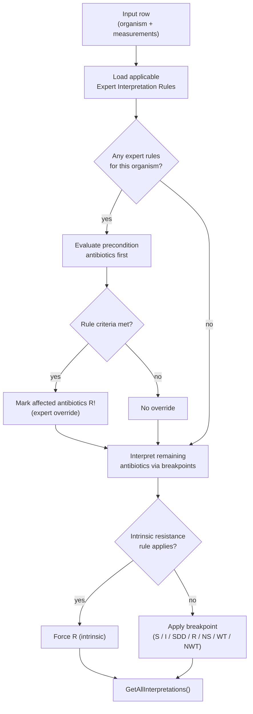

# Clinical Methodology

> **Diátaxis:** This is an *explanation* document. It explains the clinical standards AMRIE implements, what each interpretive category means, and why the engine is designed the way it is for AMR surveillance and research contexts.

## Overview

AMRIE (Antimicrobial Resistance Test Interpretation Engine) automates the assignment of **interpretive categories** to quantitative antimicrobial susceptibility test (AST) measurements. It does this by applying breakpoints and expert rules published by internationally recognised standards bodies:

| Guideline Body | Abbreviation | Scope |
|---|---|---|
| Clinical and Laboratory Standards Institute | **CLSI** | Human and veterinary medicine (North America and globally) |
| European Committee on Antimicrobial Susceptibility Testing | **EUCAST** | Human medicine (Europe and globally) |
| Société Française de Microbiologie | **SFM / CA-SFM** | Human and veterinary medicine (France) |

Each guideline defines its own breakpoint tables and intrinsic resistance rules. AMRIE selects the applicable guideline for each antibiotic column based on the **WHONET column naming convention** (e.g., `PEN_ND10` / `PEN_NM` / `PEN_NE` → CLSI; `AMK_ED30` / `AMP_EM` / `AMP_EE` → EUCAST; `FOX_FD30` / `FOX_FM` / `FOX_FE` → SFM; or user-defined antibiotics like `X_1_ND10`). Users can further constrain which guideline years and breakpoint types are considered via [`InterpretationConfiguration`](../../AMRIE.Library/InterpretationConfiguration.cs).

## Why These Three Guidelines?

The choice of CLSI, EUCAST, and SFM reflects the global distribution of WHONET users. WHONET is the WHO's reference software for AMR surveillance, used in thousands of laboratories across more than 120 countries. Its column naming convention encodes the guideline as the first letter following the antibiotic code underscore (`N` for CLSI, `E` for EUCAST, `F` for SFM), followed by the test method (`D` for Disk diffusion, `M` for MIC, `E` for ETest), and an optional disk potency for disk diffusion tests. As a result, a file exported from WHONET can carry measurements for multiple guidelines simultaneously. AMRIE is designed to be a drop-in interpretation engine for WHONET-formatted data.

> [!NOTE]
> See [`licenses/CLINICAL-DATA-ATTRIBUTION.md`](../../licenses/CLINICAL-DATA-ATTRIBUTION.md) for the full legal attributions to CLSI, EUCAST, SFM, and WHONET.

## WHONET and AMR Surveillance Context

WHONET (whonet.org) is maintained by the WHO Collaborating Centre for Surveillance of Antimicrobial Resistance at Brigham and Women's Hospital / Mass General Brigham, Boston, USA. It provides:

- **Three-letter organism codes** (`WHONET_ORG_CODE`) used as the primary key when looking up breakpoints.
- **Three-letter antibiotic codes** (e.g., `PEN`, `AMP`, `FOX`) followed by a method/guideline suffix that AMRIE parses via `IsolateInterpretation.ValidAntibioticFieldNameRegex`.
- Taxonomic, ATC, AWaRe, LOINC, and SNOMED mappings embedded in the resource tables.

AMRIE is not a clinical diagnostic device. It is designed for research and epidemiological surveillance use. See the disclaimer in [§ Clinical Disclaimer](#clinical-disclaimer) below.

## Measurement Types

AMRIE interprets three AST measurement types:

| Type | Unit | Column suffix pattern | Valid range |
|---|---|---|---|
| **MIC** (Minimum Inhibitory Concentration) | mg/L | `_NM`, `_EM`, `_FM`, … (suffix ends in `M`) | 0.0001 – 2048 mg/L |
| **Disk diffusion** | mm (zone diameter) | `_ND6`, `_ND10`, `_ED6`, … (suffix contains `D` followed by disk size) | 6 – 80 mm |
| **ETest** | mg/L | `_NE`, `_EE`, … (suffix ends in `E`) | same range as MIC |

The measurement type is encoded in the WHONET antibiotic column name and is extracted by `AntibioticComponents` when the field name is parsed. This allows the engine to apply the correct breakpoint type (MIC or disk) for each measurement without requiring user intervention.

### Half-Dilution Rounding (`RoundHalfDilutions`)

MIC values are reported on a standard doubling dilution series (…0.125, 0.25, 0.5, 1, 2, 4…). Some instruments report half-dilution steps (e.g., 1.5 or 3) that fall between standard series points.

When `RoundHalfDilutions = true` (the default in `InterpretationConfiguration`), the engine rounds such values **up** to the next standard dilution before applying breakpoints. This matches the convention recommended by CLSI and EUCAST. Setting `RoundHalfDilutions = false` disables this rounding — useful for research contexts where raw instrument values must be preserved for statistical analysis.

## Interpretive Categories

AMRIE can assign the following interpretive categories, as defined in [`Constants.InterpretationCodes`](../../AMRIE.Library/Constants.cs):

| Code | Full Name | Definition |
|---|---|---|
| `S` | **Susceptible** | The isolate is inhibited by the normally achievable concentration of the agent at the recommended dosage. Treatment is likely to succeed. |
| `I` | **Intermediate** | The isolate has a reduced susceptibility. Treatment may succeed at higher doses, in body compartments where the drug concentrates, or when other factors apply. EUCAST defines I as "Susceptible, Increased Exposure". |
| `SDD` | **Susceptible, Dose-Dependent** | (CLSI-specific) The likelihood of treatment success depends on the dosage regimen used. Used where a higher dose achieves efficacy against an organism not met by the standard dose. |
| `R` | **Resistant** | Treatment with this agent is likely to fail. The isolate is not inhibited by concentrations achievable with standard dosage regimens. |
| `NS` | **Non-Susceptible** | Used for agents where only a susceptible breakpoint has been defined. An isolate that is not Susceptible is reported as NS rather than R. |
| `WT` | **Wild Type** | (Epidemiological cutoff / ECOFF) The isolate has no acquired or mutational resistance mechanisms — its MIC distribution falls within the wild-type population. |
| `NWT` | **Non-Wild Type** | (Epidemiological cutoff / ECOFF) The isolate has an MIC above the epidemiological cutoff, indicating a likely acquired resistance mechanism, even if the clinical breakpoint for R has not been reached. |

Additionally, results can carry **modifier flags**:

| Flag | Meaning |
|---|---|
| `!` (exclamation point) | Interpretation was overridden by an **expert rule** (e.g., inferred methicillin resistance in *S. aureus*). |
| `*` (asterisk) | The result carries a clinical comment or footnote from the guideline. |

The `IsolateInterpretation.RemoveComments()` method strips these flags from interpretations when `IncludeInterpretationComments = false`.

## Interpretation Pipeline

For each isolate row, the engine applies rules in this order:

**Expert interpretation rules** cover phenotypic inferences that cannot be made from a single drug's MIC alone — the canonical example is methicillin-resistant *Staphylococcus aureus* (MRSAph), where a positive oxacillin result causes all β-lactams to be reported as Resistant. Expert rules are configurable and can be selectively enabled or disabled in `InterpretationConfiguration.EnabledExpertInterpretationRules`.

**Intrinsic resistance rules** encode species-level resistance that is independent of measurement — e.g., all isolates of *Klebsiella* spp. are intrinsically resistant to ampicillin regardless of the measured MIC.

## Configuration Model

[`InterpretationConfiguration`](../../AMRIE.Library/InterpretationConfiguration.cs) governs every aspect of the engine's behaviour:

| Property | Default | Purpose |
|---|---|---|
| `GuidelineYear` | Current breakpoint table year | Which annual edition of breakpoints to apply |
| `RoundHalfDilutions` | `true` | Round half-dilution MICs up to the standard series |
| `PrioritizedBreakpointTypes` | Human | Filter breakpoints by type (Human, Animal, ECOFF, …) |
| `PrioritizedSitesOfInfection` | `DefaultOrder` | Tie-breaking order when multiple site-specific breakpoints exist |
| `DisabledSitesOfInfection` | (none) | Suppress specific infection sites from consideration |
| `EnabledExpertInterpretationRules` | MRSAph, BLNAR, ICR | Active expert rule codes; `null` = all defaults |
| `UseIntrinsicResistanceRules` | `true` | Apply species-level intrinsic resistance rules |
| `HorizontalAntibioticResults` | `true` | Output layout: horizontal (one column per antibiotic) vs. vertical (one row per antibiotic) |
| `IncludeInterpretationComments` | `false` | Include `!` / `*` modifier flags in output |
| `UserDefinedBreakpointsFile` | (none) | Path to a custom breakpoints table that supplements built-in tables |

The configuration is serialised as JSON and loaded by `InterpretationConfiguration.ReadConfiguration()`. It tolerates JSON comments and trailing commas.

## Clinical Disclaimer

> [!CAUTION]
> The breakpoint tables and interpretation algorithms in AMRIE are provided **solely for research, epidemiological surveillance, and informational purposes**. They do **not** constitute medical advice or a certified in-vitro diagnostic (IVD) medical device.
>
> Clinical laboratories are responsible for verifying all breakpoints and rules against the current official guideline documents (CLSI M100, EUCAST Clinical Breakpoint Tables, CA-SFM publications) prior to patient reporting. See [`licenses/CLINICAL-DATA-ATTRIBUTION.md`](../../licenses/CLINICAL-DATA-ATTRIBUTION.md) for the full attribution notice and warranty disclaimer.

---

# See Also

- [System Architecture](./system-architecture.md) — project structure, build targets, deployment
- [Memory and Caching](./memory-and-caching.md) — batch streaming and BoundedCache design
- [Interpretation Algorithm](./interpretation-algorithm.md) — detailed walkthrough of breakpoint selection logic
- [Resource Data Schemas](../reference/resource-data-schemas.md) — column definitions for `Breakpoints.txt`, `Organisms.txt`, and other resource files
- [`IsolateInterpretation.cs`](../../AMRIE.Library/IsolateInterpretation.cs) — interpretation entry point
- [`InterpretationConfiguration.cs`](../../AMRIE.Library/InterpretationConfiguration.cs) — configuration model
- [`Constants.cs`](../../AMRIE.Library/Constants.cs) — interpretation code and measurement constant definitions
