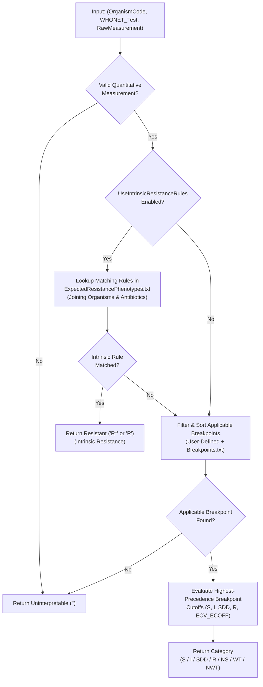
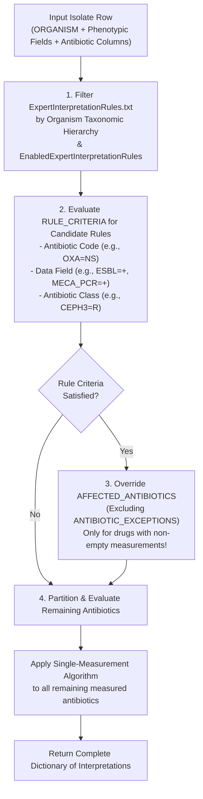

# Antimicrobial Susceptibility Interpretation Algorithm

This document specifies the core algorithms implemented by `AMRIE.Library` to interpret quantitative antibiotic susceptibility test (AST) measurements. It replaces and expands the legacy specification formerly distributed as `AMR Interpretation Algorithm and Resources.docx`.

---

## 1. Architectural Philosophy: Externalized Clinical Logic

AMRIE separates **execution logic** (written in C# within `AMRIE.Library`) from **clinical guideline knowledge** (externalized in tab-delimited text files under `Resources/`). This separation provides two major benefits:
1. **Zero-Code Guideline Updates:** Annual updates to CLSI, EUCAST, and SFM breakpoints, intrinsic resistance rules, and quality control ranges can be deployed by updating the resource tables without modifying application code.
2. **Cross-Platform & Database Independence:** Third-party systems can either call `AMRIE.Library` directly in-memory (backed by `BoundedCache`) or import the tab-delimited tables into a relational database using the reference queries in [SQL Reference Queries](../reference/sql-reference-queries.md).

---

## 2. Measurement Parsing, Normalization & Rounding

Before comparing a quantitative test result against a breakpoint rule, `InterpretationLibrary.ParseResult` normalizes the raw input string based on the test method inferred from the WHONET test code (e.g., `PEN_ND10` $\to$ Disk Diffusion; `AMC_NM` $\to$ MIC; `VAN_NE` $\to$ ETest):

### Disk Diffusion (`DISK`)
- **Valid Range:** Integer values from $6\text{ mm}$ to $80\text{ mm}$ (`Constants.Disk.MinimumDiskMeasurement` to `MaximumDiskMeasurement`).
- Values outside $[6, 80]$ or non-integer decimals (e.g., `6.5`) are rejected as uninterpretable.

### Minimal Inhibitory Concentration (`MIC` & `ETEST`)
- **Valid Range:** Numeric values from $0.0001\ \mu\text{g/mL}$ to $2048\ \mu\text{g/mL}$.
- **Inequality Modifiers:**
  - `<=X` or `=X` or `X` $\to$ value $X$ with modifier `<=` or `=`.
  - `<X` $\to$ normalized to $X / 2$ with modifier `<=` (one doubling dilution down, e.g., `<8` $\to$ `<=4`).
  - `>=X` $\to$ normalized to $X / 2$ with modifier `>` (e.g., `>=8` $\to$ `>4`).
  - `>X` $\to$ value $X$ with modifier `>`.
  - Unicode symbols (`≤`, `≥`) are not valid WHONET modifiers; standard ASCII (`<=`, `>=`, `<`, `>`) must be used.
- **Half-Dilution Rounding (`RoundHalfDilutions = true`):**
  - ETest gradient strips and certain automated systems report intermediate values (e.g., $0.016, 0.032, 0.064, 0.125, 0.19, 0.38, 0.75, 1.5, 3, 6, 12, 24, 48, 96, 192\ \mu\text{g/mL}$).
  - When `RoundHalfDilutions` is enabled, `InterpretationLibrary.Round_ETestHalfDilutionsUp` rounds intermediate MIC values **up** to the next standard two-fold doubling dilution ($0.001, 0.002, 0.004, 0.008, 0.015, 0.016, 0.03, 0.032, 0.06, 0.064, 0.12, 0.125, 0.25, 0.5, 1, 2, 4, 8, \dots$) prior to breakpoint comparison.

---

## 3. Single-Measurement Interpretation Algorithm

The single-measurement algorithm (`AntibioticSpecificInterpretationRules.GetInterpretation`) evaluates a single `(Organism, AntibioticTest, Measurement)` tuple in isolation:

### Step-by-Step Execution
1. **Intrinsic Resistance Check:**
   - If `UseIntrinsicResistanceRules` is `true` (default), AMRIE checks whether the `(OrganismCode, Guideline, AntibioticCode)` matches any rule in `ExpectedResistancePhenotypes.txt`.
   - Organism matching traverses the taxonomic hierarchy defined in `Organisms.txt` (from `SEROVAR_GROUP` and `WHONET_ORG_CODE` up to `FAMILY_CODE` and `ANAEROBE`), while excluding any organism listed in `EXCEPTION_ORGANISM_CODE` or drug listed in `ANTIBIOTIC_EXCEPTIONS`.
   - If a match is found, the measurement is immediately interpreted as **Resistant** (`R*` when `IncludeInterpretationComments = true`, or `R` otherwise).
2. **Breakpoint Lookup & Precedence Sorting:**
   - If the organism is not intrinsically resistant, AMRIE filters `Breakpoints.txt` (and any `UserDefinedBreakpoints`) by the requested guideline, year (`<= GuidelineYear`), test method (`DISK` vs `MIC`), disk potency, and organism hierarchy.
   - Candidate breakpoints are sorted deterministically from most-specific to least-specific according to the [Rule Precedence & Taxonomic Hierarchy](rule-precedence-hierarchy.md).
3. **Threshold Evaluation:**
   - Using the top-ranked applicable breakpoint:
     - **Human / Animal Clinical Breakpoints:** Evaluates `S`, `I`, `SDD`, and `R` cutoffs. If a measurement falls beyond a one-sided `S` threshold with no `I` or `R` cutoff defined, it is reported as Non-Susceptible (`NS`).
     - **Epidemiological Cutoff Values (`BREAKPOINT_TYPE = ECOFF`):** Evaluates `ECV_ECOFF` to classify the isolate as Wild-Type (`WT`) or Non-Wild-Type (`NWT`).

---

## 4. Complete-Isolate Interpretation Algorithm

When interpreting a full isolate record (`IsolateInterpretation`), individual antibiotic measurements cannot be evaluated purely in isolation because **Expert Interpretation Rules** (`ExpertInterpretationRules.txt`) allow one test result or phenotypic marker to override the clinical interpretation of multiple other antibiotics.

### Stage 1: Evaluate Expert Interpretation Rules (`GetExpertInterpretations`)
Prior to evaluating general intrinsic resistance or routine breakpoints across the row, AMRIE evaluates all enabled expert rules matching the isolate's organism:

1. **Rule Criteria Evaluation (`RULE_CRITERIA`):**
   Each rule specifies boolean criteria (joined by `AND` / `OR`) of three types:
   - **Three-Letter Antibiotic Code (e.g., `OXA=NS`, `AMP=NS`):** AMRIE runs the *Single-Measurement Algorithm* on all tests for that antibiotic on the isolate to check whether the precondition is met.
   - **Phenotypic / Molecular Data Field (e.g., `ESBL=+`, `MECA_PCR=+`, `BETA_LACT=-`, `INDUC_CLI=+`):** AMRIE checks the corresponding column value in the isolate's data row.
   - **Antibiotic Profile Class (`CEPH3=R`):** Used by `ESBL-AMPC-PROBABLE`. AMRIE looks up all third-generation cephalosporins (`PROF_CLASS = "CEPH3"` in `Antibiotics.txt`) present on the isolate and checks if any evaluates to Resistant (`R`).

2. **Cascading Overrides (`AFFECTED_ANTIBIOTICS` & `ANTIBIOTIC_EXCEPTIONS`):**
   When an expert rule is activated, its `AFFECTED_ANTIBIOTICS` specify either:
   - Individual three-letter antibiotic codes (e.g., `MOX,CID,MAN,CFP`), or
   - Antibiotic class names matching the `CLASS` column in `Antibiotics.txt` (e.g., `Penicillins,Cephems,Cephems-Oral,Monobactams,Penems`).
   - Any drug listed in `ANTIBIOTIC_EXCEPTIONS` (such as anti-MRSA cephalosporins `CPT` [Ceftaroline] and `BPR` [Ceftobiprole] under the `MRS` rule) is excluded from the override.

> [!IMPORTANT]
> **Non-Imputation Rule:** An activated expert rule overrides an affected antibiotic **only if the isolate row actually contains a quantitative test measurement for that antibiotic**. AMRIE never fabricates or outputs resistant interpretations for unmeasured antibiotics, preventing statistical bias in cumulative antibiograms.

### Stage 2: Partitioning & Final Evaluation (`GetAllInterpretations`)
After expert rule evaluation completes, the isolate's tested antibiotics fall into three disjoint sets:
1. **Precondition Antibiotics:** Antibiotics already evaluated while testing `RULE_CRITERIA` (their interpretations are already cached in `ResultInterpretations`).
2. **Expert-Overridden Antibiotics:** Measured antibiotics belonging to `AFFECTED_ANTIBIOTICS` of an activated expert rule (already set to `R!` or `R`).
3. **Remaining Measured Antibiotics:** All other non-blank antibiotic columns on the isolate. AMRIE applies the **Single-Measurement Algorithm** to each of these remaining columns.

