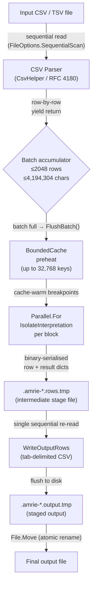
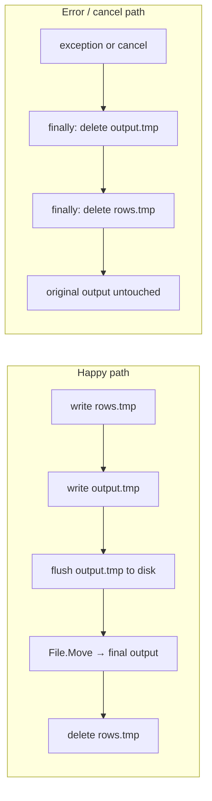
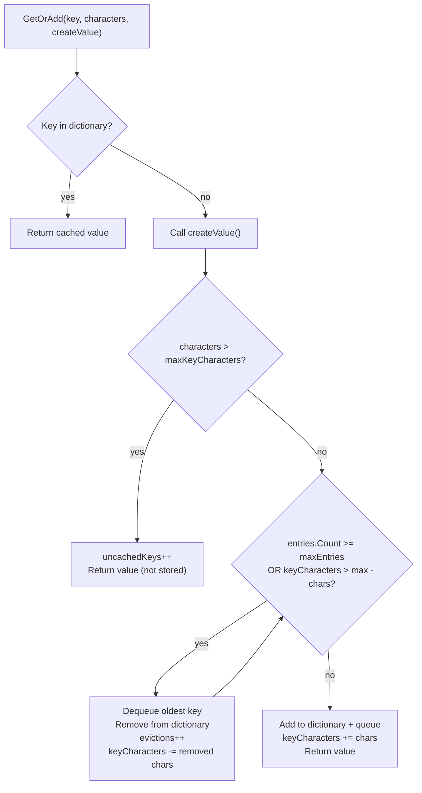

# Memory and Caching

> **Diátaxis:** This is an *explanation* document. It explains why AMRIE is designed to process data in bounded batches and how the caching layer keeps memory consumption predictable regardless of input size.

## Why Bounded Memory Matters

Antimicrobial resistance datasets can be enormous — hospital aggregations, national surveillance exports from WHONET, or multi-year research archives routinely exceed millions of rows. A naïve implementation that loads the entire file into memory before interpreting it would make AMRIE unusable on ordinary clinical workstations.

AMRIE avoids this by enforcing **two independent limits** on how much data is ever resident in memory at one time:

| Limit | Default Value | Configured by |
|---|---|---|
| Batch row limit | **2,048 rows** | `FileInterpretationParameters.BatchRowLimit` |
| Batch character limit | **4,194,304 chars** | `FileInterpretationParameters.BatchCharacterLimit` |

A batch is flushed to disk as soon as either limit is reached. This means memory usage is O(1) with respect to file size — it scales with the limits, not with the number of rows in the input.

## Data Flow

The two temporary files (`.rows.tmp` and `.output.tmp`) are created with `FileOptions.SequentialScan` and 65 536-byte I/O buffers, ensuring the OS page cache is not polluted and large files are streamed efficiently.

## Atomic Publish Pattern

The final output file is never written in-place. Instead:

1. All interpreted rows are assembled into a **stage file** (`.amrie-{guid}.output.tmp`) in the same directory as the intended output.
2. Only after the stage file is fully written and flushed to disk (`output.Flush(flushToDisk: true)`) is it atomically renamed to the target path via `File.Move(..., overwrite: true)`.
3. If anything fails — a cancellation, an I/O error, an interpretation exception — the `finally` block deletes both temporary files, leaving the original output file (if it existed) untouched.

This pattern guarantees that a consumer polling the output directory will never observe a partially written file. The output either exists and is complete, or it does not exist.

## BoundedCache: FIFO Eviction

`BoundedCache<TKey, TValue>` is a thread-safe, size-bounded in-memory cache used to avoid recomputing breakpoint lookups for recurring organism–antibiotic pairs.

### Why FIFO, not LRU?

Breakpoint lookups are keyed on `(organism, guideline, antibiotic)` triples. Within a single batch the access pattern is essentially sequential — the same keys that appear early in the batch tend not to repeat often later. FIFO eviction avoids the per-access bookkeeping overhead of LRU without materially changing the hit rate for this workload. The comment in the source is explicit:

> _"FIFO eviction does not retain an access history or change exact lookup keys."_

### Eviction Algorithm

The cache maintains two parallel structures:

- `Dictionary<TKey, (TValue Value, long Characters)>` — O(1) lookup by key
- `Queue<TKey>` — insertion-order sequence for eviction

When a new entry cannot fit because either `maxEntries` or `maxKeyCharacters` would be exceeded, the cache dequeues (and removes from the dictionary) the **oldest** key, repeating until there is room. Keys whose character length alone exceeds `maxKeyCharacters` are computed but **never cached** — they are counted as `uncachedKeys` in the statistics.

All mutations are protected by a single `lock (sync)` object, making the cache safe for concurrent access from the `Parallel.For` batches.

### Statistics

`BoundedCacheStatistics` (a `readonly record struct`) exposes four counters:

| Field | Meaning |
|---|---|
| `Entries` | Number of entries currently resident |
| `KeyCharacters` | Total character-length of all cached keys |
| `Evictions` | Cumulative evictions since last `Clear()` |
| `UncachedKeys` | Keys whose size exceeded the per-key limit and were never stored |

These counters help diagnose inefficient cache sizing without requiring a profiler.

## Preheat Hints

Before the `Parallel.For` loop interprets a batch, `IO_Library` performs a **preheat pass**:

1. Scan the batch (up to **32,768 unique `(organism, guideline, drug)` keys**) to collect the set of breakpoint lookups that will be needed.
2. Call `AntibioticSpecificInterpretationRules.PreheatBreakpointCache(...)` with this key set.
3. The cache is now warm for every breakpoint the parallel workers will need.

Preheating avoids lock contention during the parallel interpretation phase: each worker thread finds its breakpoints already cached rather than competing to populate them.

## Memory Guarantees

| Property | Guarantee |
|---|---|
| Input buffering | At most one row's parsed fields in memory at a time (streaming `yield return`) |
| Batch size | ≤ 2,048 rows **and** ≤ 4,194,304 characters |
| Breakpoint cache | Bounded by `maxEntries` and `maxKeyCharacters`; never grows unboundedly |
| Preheat key set | Capped at 32,768 keys per batch |
| Output staging | Written to a temp file, never accumulated in RAM |
| Antibiotic value canonicalisation | Capped at 4,096 entries / 65,536 characters |

No collection in the hot path is unbounded. The system is safe to run on workstations with modest RAM against files of arbitrary row count.

---

# See Also

- [System Architecture](./system-architecture.md) — project structure and deployment topologies
- [Clinical Methodology](./clinical-methodology.md) — interpretation categories and guideline support
- [`BoundedCache.cs`](../../AMRIE.Library/BoundedCache.cs) — cache implementation
- [`IO_Library.cs`](../../AMRIE.Library/IO_Library.cs) — batch streaming and atomic publish
