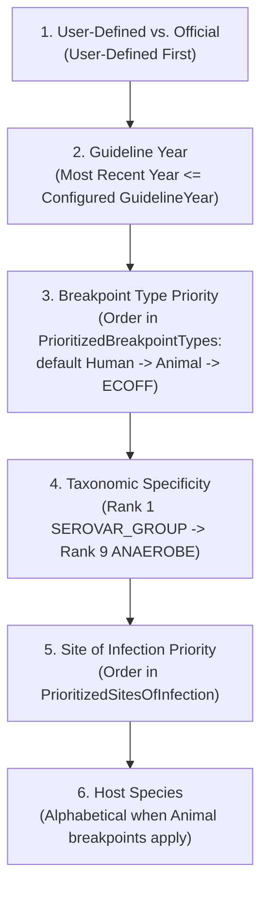

# Rule Precedence & Taxonomic Hierarchy

When interpreting a quantitative antibiotic measurement, multiple candidate rules in `Breakpoints.txt` or `ExpectedResistancePhenotypes.txt` may apply to the same isolate. For example, *Escherichia coli* (`eco`) is simultaneously a member of its serovar group (`ECO`), species/genus (`ES-`), and family *Enterobacterales* (`EBC`). Furthermore, a drug may have separate breakpoints for different sites of infection (e.g., *Meningitis* vs. *Non-meningitis*) or breakpoint types (*Human*, *Animal*, *ECOFF*).

This document defines the deterministic precedence hierarchy used by `AMRIE.Library` (`Breakpoint.GetApplicableBreakpoints` and `ExpectedResistancePhenotypeRule.GetApplicableRules`) to select the primary rule.

---

## 1. User-Defined Breakpoints Override

If custom breakpoints are configured via `UserDefinedBreakpointsFile` (or `InterpretationConfiguration.UserDefinedBreakpoints`), they are evaluated **before** official guideline tables.
- Within user-defined breakpoints, the same specificity and sorting rules below apply, with `GUIDELINES = "USER"`.

---

## 2. Taxonomic Specificity Hierarchy (`ORGANISM_CODE_TYPE`)

Both `Breakpoints.txt` and `ExpectedResistancePhenotypes.txt` link to `Organisms.txt` (`TAXONOMIC_STATUS = 'C'`) via the `ORGANISM_CODE` and `ORGANISM_CODE_TYPE` columns.

AMRIE ranks matches from **most specific (Rank 1)** to **broadest taxonomic group (Rank 9)**:

| Precedence Rank | `ORGANISM_CODE_TYPE` | `Organisms.txt` Join Condition | Clinical Example |
| :---: | :--- | :--- | :--- |
| **1 (Highest)** | `SEROVAR_GROUP` | `o.SEROVAR_GROUP = rule.ORGANISM_CODE` | *Salmonella* Typhi / Paratyphi vs. non-typhoidal *Salmonella* |
| **2** | `WHONET_ORG_CODE` | `o.WHONET_ORG_CODE = rule.ORGANISM_CODE` | Specific organism code (e.g., `spn` for *S. pneumoniae*, `sau` for *S. aureus*) |
| **3** | `SPECIES_GROUP` | `o.SPECIES_GROUP = rule.ORGANISM_CODE` | *Streptococcus viridans* group (`svi`) or *B. cepacia* complex |
| **4** | `GENUS_CODE` | `o.GENUS_CODE = rule.ORGANISM_CODE` | Genus-wide rules (e.g., `STA` for *Staphylococcus* spp., `ENT` for *Enterococcus* spp.) |
| **5** | `GENUS_GROUP` | `o.GENUS_GROUP = rule.ORGANISM_CODE` | Beta-hemolytic *Streptococcus* groups |
| **6** | `FAMILY_CODE` | `o.FAMILY_CODE = rule.ORGANISM_CODE` | Family-level breakpoints (e.g., `EBC` for *Enterobacterales*) |
| **7** | `SUBKINGDOM_CODE` | `o.SUBKINGDOM_CODE = rule.ORGANISM_CODE` | Gram-positive (`+`) or Gram-negative (`-`) (used in Intrinsic Resistance) |
| **8** | `ANAEROBE+SUBKINGDOM_CODE` | `o.ANAEROBE = 'X'` and `AN+` / `AN-` | Gram-positive anaerobes (`AN+`) or Gram-negative anaerobes (`AN-`) |
| **9 (Broadest)** | `ANAEROBE` | `o.ANAEROBE = 'X'` and `ANA` | All anaerobes (`ANA`) |

> [!NOTE]
> **Why Specificity Matters:** If CLSI defines a specific breakpoint for *Proteus mirabilis* (`pmi`, Rank 2) as well as a general breakpoint for *Enterobacterales* (`EBC`, Rank 6), Rank 2 sorts ahead of Rank 6 so the species-specific threshold is always applied first.

---

## 3. Breakpoint Sorting Order

When `Breakpoint.GetApplicableBreakpoints` queries candidate breakpoints for a given organism and antibiotic test, it sorts matching rows using the following multi-key precedence order:

### Key 1: User-Defined Precedence
Custom breakpoints loaded from `UserDefinedBreakpoints` take precedence over built-in `Breakpoints.txt` rules.

### Key 2: Guideline Recency (`YEAR`)
AMRIE filters for breakpoints up to `InterpretationConfiguration.GuidelineYear` (e.g., `2026`) and selects the most recent available year for that guideline/drug/organism combination.

### Key 3: Breakpoint Type (`PrioritizedBreakpointTypes`)
Breakpoints are categorized into three `BREAKPOINT_TYPE` values:
1. `Human` — Clinical breakpoints for human patient care.
2. `Animal` — Veterinary clinical breakpoints (further stratified by `HOST`, e.g., Cattle, Swine, Dog, Horse).
3. `ECOFF` — Epidemiological Cut-Off values distinguishing Wild-Type (`WT`) from Non-Wild-Type (`NWT`) populations.

Candidate breakpoints are ordered according to their index in `InterpretationConfiguration.PrioritizedBreakpointTypes`. If a type is omitted from `PrioritizedBreakpointTypes` (when the list is non-null), breakpoints of that type are excluded.

### Key 4: Taxonomic Specificity (`ORGANISM_CODE_TYPE`)
Sorted by the 9-level taxonomic rank table in [Section 2](#2-taxonomic-specificity-hierarchy-organism_code_type).

### Key 5: Site of Infection (`PrioritizedSitesOfInfection`)
Many organism-drug pairs have distinct clinical cutoffs depending on the anatomical site of infection or administration route (e.g., *Streptococcus pneumoniae* with Penicillin or Ceftriaxone has different breakpoints for `Meningitis` vs. `Non-meningitis` vs. `Oral`).

- Any site listed in `DisabledSitesOfInfection` is excluded from consideration.
- Remaining sites are sorted according to their position in `PrioritizedSitesOfInfection`.
- By default (`Constants.SitesOfInfection.DefaultOrder`), general systemic sites sort ahead of specialized indications:
  1. `Non-meningitis`
  2. `Non-endocarditis`
  3. `Parenteral`
  4. `(Blank)` (unspecified / general site)
  5. `Uncomplicated urinary tract infection`
  6. `Infections originating from the urinary tract`
  7. `Meningitis`
  8. `Endocarditis`
  9. *(Followed by remaining specialized sites in `Constants.SitesOfInfection.DefaultOrder`)*

---

## 4. Intrinsic Resistance Exception Resolution

In `ExpectedResistancePhenotypes.txt`, a broad taxonomic rule (such as `FAMILY_CODE = EBC` or `GENUS_CODE = ENT`) may define one or more comma-separated exclusions in `EXCEPTION_ORGANISM_CODE` qualified by `EXCEPTION_ORGANISM_CODE_TYPE`.

- During evaluation, AMRIE first verifies that the isolate's organism matches `(ORGANISM_CODE, ORGANISM_CODE_TYPE)`.
- Next, it checks whether the isolate's organism matches any code in `EXCEPTION_ORGANISM_CODE` at the specified `EXCEPTION_ORGANISM_CODE_TYPE` level. If so, the intrinsic resistance rule is **not** applied.
- Similarly, if the rule matches via a broad ATC prefix (`ABX_CODE_TYPE = ATC_CODE`), any drug listed in `ANTIBIOTIC_EXCEPTIONS` is excluded from the rule.

