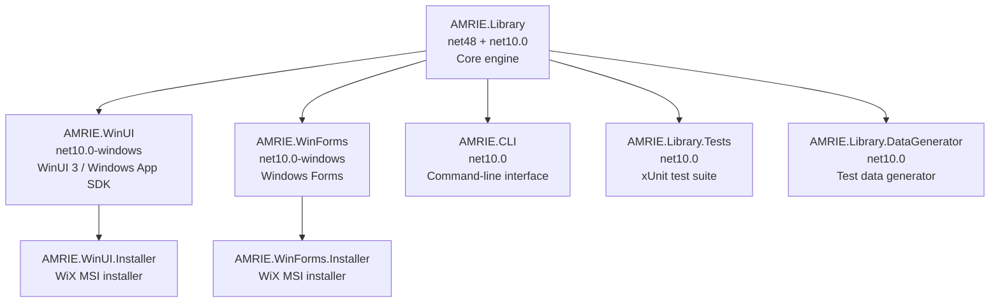
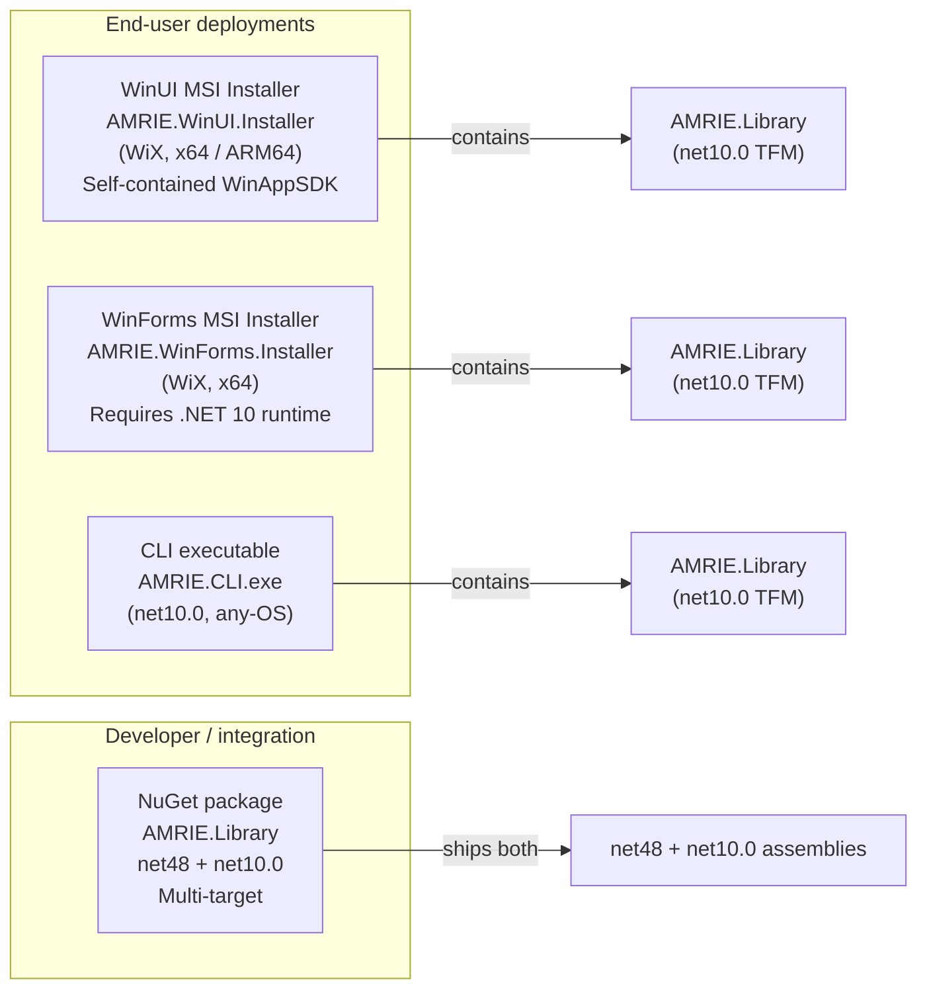

# System Architecture

> **Diátaxis:** This is an *explanation* document. It explains why AMRIE is structured as multiple projects, why the core library targets two .NET runtimes simultaneously, and how the deployment artifacts relate to those projects.

## Why Multiple Projects?

AMRIE separates concerns across projects so that the interpretation engine can be consumed in three distinct deployment modes — a modern WinUI 3 desktop application, a legacy WinForms desktop application, and a command-line tool — without duplicating clinical logic. A NuGet-publishable library is also a first-class output.



`AMRIE.Library` is the only project that contains clinical logic, breakpoint tables, and resource files. All other projects are thin consumers of it. This means the interpretation engine can be tested and distributed independently of any UI.

## Why `net48` and `net10.0` Together?

`AMRIE.Library` deliberately targets both `net48` (the final .NET Framework 4.8 release) and `net10.0` (the current .NET release). This dual-targeting decision is rooted in the laboratory software ecosystem:

- **Many hospitals and clinical research institutions still run Windows environments locked to .NET Framework.** Software distribution in these environments is often tightly controlled, and upgrading the runtime is not trivial. Supporting `net48` means AMRIE.Library can be consumed as a NuGet package or referenced directly from legacy WinForms applications without requiring a runtime upgrade.
- **New front-ends (`WinUI`, `CLI`) target `net10.0`** to take advantage of modern performance improvements, nullable reference types, and the Windows App SDK.
- **Compatibility shims for `net48`:** the `PolyfillLib` package (11.4.5) backports modern .NET APIs (`ArgumentOutOfRangeException.ThrowIfNegativeOrZero`, `ReadOnlySpan`, collection expressions, etc.) to `net48`. `System.Text.Json` (10.0.14) is similarly brought in explicitly for the `net48` target because it is not part of the .NET Framework BCL.
- **Language version pinned to C# 14.0 on `net48`** to avoid using language features that the polyfills cannot support.

The MSBuild project file expresses this cleanly with conditional `ItemGroup`s:

```xml
<TargetFrameworks>net48;net10.0</TargetFrameworks>

<ItemGroup Condition="'$(TargetFramework)' == 'net48'">
  <PackageReference Include="PolyfillLib" Version="11.4.5" />
  <PackageReference Include="System.Text.Json" Version="10.0.14" />
</ItemGroup>
```

## Tech Stack by Project

### AMRIE.Library

| Aspect | Value |
|---|---|
| Target frameworks | `net48`, `net10.0` |
| Key NuGet packages | `CsvHelper` 34.0.0 (CSV parsing), `PolyfillLib` 11.4.5 (net48 only), `System.Text.Json` 10.0.14 (net48 only) |
| Embedded resources | `Breakpoints.txt`, `Organisms.txt`, `Antibiotics.txt`, `QC_Ranges.txt`, `ExpertInterpretationRules.txt`, `ExpectedResistancePhenotypes.txt`, `SampleConfig.json`, `SampleInputFile.txt`, `SampleUserDefinedBreakpoints.txt` |
| Localisation | `Translations/Resources.resx` (compiled to `Resources.Designer.cs`) |
| Test visibility | `InternalsVisibleTo` granted to `AMRIE.Library.Tests` and legacy performance projects |
| Code signing (Release) | `signtool.exe` via MSBuild `SignFrameworkEngine` target (net48 only) |

### AMRIE.WinUI

| Aspect | Value |
|---|---|
| Target framework | `net10.0-windows10.0.26100.0` (minimum `10.0.17763.0` / Windows 10 1809) |
| UI framework | WinUI 3 via **Microsoft.WindowsAppSDK** 2.5.4-experimental |
| Key NuGet packages | `CommunityToolkit.Mvvm` 8.4.0 (MVVM), `Microsoft.Web.WebView2` 1.0.3719.77, `Microsoft.Windows.SDK.BuildTools` 10.0.28000.2705 |
| Output type | `WinExe` (unpackaged; `WindowsPackageType=None`) |
| Distribution | Windows App SDK self-contained (`WindowsAppSDKSelfContained=true`); ReadyToRun in Release |
| Installer | `AMRIE.WinUI.Installer` (WiX `.wixproj`) → MSI |
| Supported platforms | `ARM64`, `AnyCPU` (resolved to host architecture at build time) |
| Company / Product | Brigham and Women's Hospital / AMR Interpretation Engine |

### AMRIE.WinForms

| Aspect | Value |
|---|---|
| Target framework | `net10.0-windows7.0` |
| UI framework | Windows Forms (`UseWindowsForms=true`) |
| Output type | `WinExe` |
| Distribution | Framework-dependent; installer via `AMRIE.WinForms.Installer` (WiX `.wixproj`) → MSI |
| Code signing | `signtool.exe` in Release post-build event |

### AMRIE.CLI

| Aspect | Value |
|---|---|
| Target framework | `net10.0` (cross-platform capable; Windows primary target) |
| Output type | `Exe` (console) |
| Code signing | `signtool.exe` in Release post-build event |
| Modes | `FILE` (batch file interpretation), `SINGLE_INTERPRETATION` (single-row stdin mode) |

### AMRIE.Library.Tests

| Aspect | Value |
|---|---|
| Target framework | `net10.0` |
| Test framework | xUnit 2.5.3 + `xunit.runner.visualstudio` |
| Coverage | `coverlet.collector` 6.0.0 |
| References | `AMRIE.Library` (via `InternalsVisibleTo`) |

## Deployment Topologies

AMRIE ships as four distinct distribution units. The library is the foundation for all of them.



### WinUI MSI

The WinUI application is built as an **unpackaged, self-contained** Windows App SDK app — it does not require the Windows App SDK to be pre-installed on the target machine because all runtime dependencies are bundled. The WiX installer (`AMRIE.WinUI.Installer`) wraps the publish output into an MSI for enterprise deployment. XAML binary resources (`.xbf`) and Package Resource Index (`.pri`) files are copied to the publish directory by a custom MSBuild target.

### WinForms MSI

The WinForms application targets `net10.0-windows7.0`, making it compatible with the widest possible range of modern Windows systems. It is framework-dependent (the .NET 10 runtime must be installed). The WiX installer (`AMRIE.WinForms.Installer`) produces the MSI.

### CLI

The CLI executable is a standard `net10.0` console application. It can be published as a framework-dependent or self-contained single-file executable for scripting, CI/CD pipeline integration, or server-side batch processing.

### NuGet Library

`AMRIE.Library`'s dual-target build produces both a `net48` and a `net10.0` assembly in the same NuGet package. Consumers on legacy .NET Framework automatically receive the `net48` TFM; .NET 5+ consumers receive `net10.0`.

## Build Entry Points

| Entry point | Purpose |
|---|---|
| `AMRIE.sln` | Full solution build in Visual Studio or `dotnet build AMRIE.sln` |
| `BuildAndRun.ps1` | Developer convenience script: build and launch the WinForms application |
| `Publish-WinUI.ps1` | Publish the WinUI application for a specified RID (e.g., `win-x64`, `win-arm64`) and hand off to the WiX installer |

Both PowerShell scripts wrap `dotnet publish` with the correct profile and platform parameters, abstracting the multi-step publish process.

---

# See Also

- [Memory and Caching](./memory-and-caching.md) — batch streaming, BoundedCache, and atomic publish
- [Clinical Methodology](./clinical-methodology.md) — interpretation categories, guideline support, and configuration
- [`AMRIE.sln`](../../AMRIE.sln) — solution file listing all projects
- [`AMRIE.Library.csproj`](../../AMRIE.Library/AMRIE.Library.csproj) — dual-target library project
- [`AMRIE.WinUI.csproj`](../../AMRIE.WinUI/AMRIE.WinUI.csproj) — WinUI 3 application project
